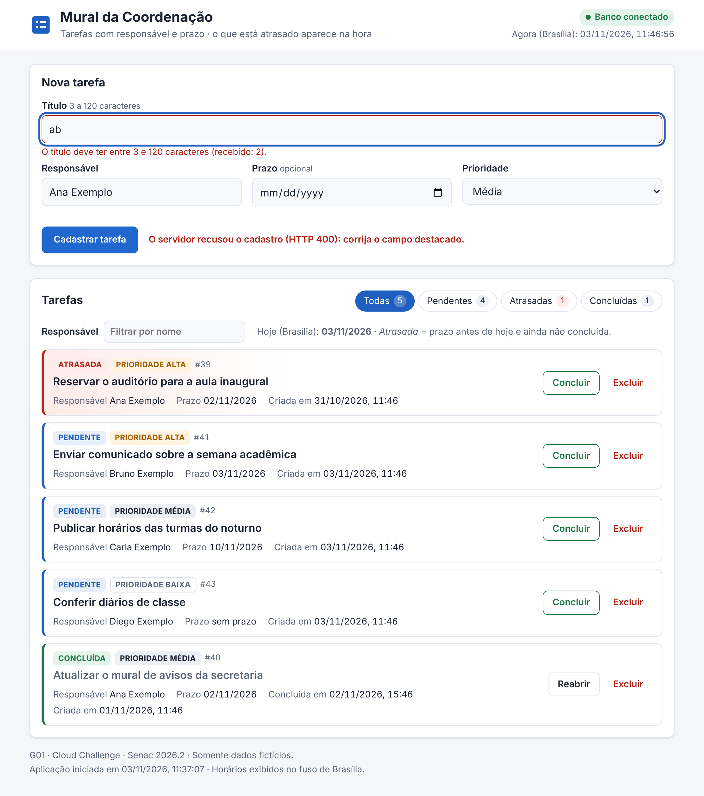
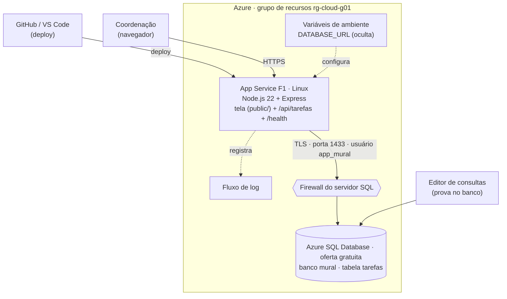
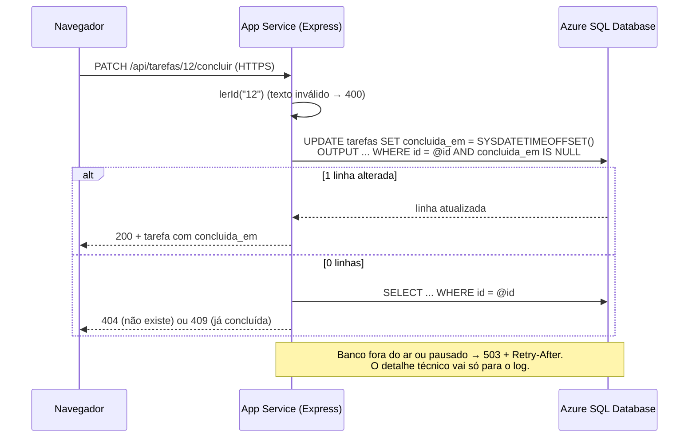

# G01 · Mural da Coordenação

**Cloud Challenge · Cloud Computing · Senac 2026.2 · Prof. Roni Maciel**

Desafio 01 (complexidade intermediária) · Nível de implantação: **A, Nuvem completa** (App Service + Azure SQL Database criados pelo grupo)

| Grupo nº | Desafio |
|---|---|
| **01** | **01: Mural da Coordenação** |

| Integrante | Papel | Responde por |
|---|---|---|
| Antonio Vinicius | **NUVEM** (banco Azure SQL) | Criou o Azure SQL (`sql-cloud-g01-avp` / `mural`), firewall, tabela e usuário `app_mural`; `DATABASE_URL` |
| Lucas Vinicius | **DEV** (interface) | Tela web (`public/`), arquivo `requisicoes.http`, demonstração ao vivo |
| Vinicius Trezena | **DADOS** | Modelo, `banco/*.sql`, restrições, usuário sem privilégio, prova de persistência no banco |
| Renan Souza | **NUVEM** (App Service e deploy) | App Service, variáveis de ambiente, deploy pelo GitHub, logs |
| Vitoria Barboza | **QA** (testes e evidências) | Casos de teste, `npm test`, prints da pasta `evidencias/` |
| Leonardo Silva | **QA** (README e pitch) | README, diagrama, roteiro e vídeo do pitch de 90 s |

Divisão detalhada, cronograma da noite e roteiro do pitch: [`docs/guia-do-grupo.md`](docs/guia-do-grupo.md).

| | |
|---|---|
| **URL pública** | `https://app-cloud-g01-SUFIXO.azurewebsites.net` ⟵ *preencher após o deploy* |
| **Vídeo do pitch (90 s)** | *adicionar o link* |



*Tela em execução local (dados fictícios): o servidor recusou um título de 2 caracteres (CA1) e a tarefa com prazo de ontem aparece como **atrasada**.*

---

## 1. Problema e usuário

A coordenação precisa reservar o auditório, publicar horários, conferir diários e enviar comunicados no início do semestre, mas hoje isso fica em post-its e grupos de mensagem: tarefas se perdem e ninguém sabe o que está atrasado. O **usuário** é o assistente acadêmico ou o coordenador, no computador da secretaria. O **Mural da Coordenação** reúne cada tarefa com responsável, prazo e prioridade, e mostra na hora o que está atrasado.

## 2. Requisitos da ficha e status

**Legenda:** ✅ feito e testado (execução local em 03/11/2026, SQL Server 2022, mesmo motor do Azure SQL) · ⏳ fazer na Azure durante a aula.

| Requisito | Como foi atendido | Status |
|---|---|---|
| **RF1** Cadastrar tarefa: título (3 a 120), responsável, prazo opcional, prioridade (baixa/média/alta; padrão média) | `POST /api/tarefas` + formulário; validação no servidor; `CHECK`s no banco | ✅ |
| **RF2** Listar com filtro por situação (pendentes, concluídas, atrasadas) | `GET /api/tarefas?situacao=...` + abas na tela | ✅ |
| **RF3** Concluir registrando data e hora **(regra central)** | `PATCH /api/tarefas/:id/concluir`: `UPDATE` atômico grava `concluida_em` | ✅ |
| **RF4** "Atrasadas" = prazo antes de hoje e não concluída **(regra central)** | Filtro no SQL, com o "hoje" de Brasília | ✅ |
| **RF5** Excluir tarefa | `DELETE /api/tarefas/:id` (exclusão física) | ✅ |
| **CA1** Título com 2 caracteres → `400` com mensagem | "O título deve ter entre 3 e 120 caracteres (recebido: 2)." | ✅ |
| **CA2** Prazo anterior a hoje no cadastro → `400` | "O prazo não pode ser anterior a hoje (dd/mm/aaaa, horário de Brasília)." | ✅ |
| **CA3** Concluir pendente → `concluida_em` preenchido; de novo → `409` | Testado também com 5 cliques simultâneos: 1 × `200` e 4 × `409` | ✅ |
| **CA4** Pendente e concluída com prazo de ontem → "atrasadas" mostra só a pendente | Preparação no banco (`banco/preparacao-teste-ca4.sql`) + filtro | ✅ |
| **CA5** Excluir id inexistente → `404` | "Tarefa não encontrada." | ✅ |
| Dados persistidos em banco de dados | Azure SQL Database (tabela `dbo.tarefas`) | ✅ local · ⏳ Azure |
| Validação no servidor e erros `400`, `404`, `409`, `503` sem detalhes internos | `src/validacao.js` e `src/erros.js`; detalhes só no log | ✅ |
| `GET /health` testa o banco | `SELECT 1` no banco; devolve `iniciado_em` | ✅ |
| String de conexão fora do código (`DATABASE_URL`); `.env` fora do Git | `src/banco.js` lê `process.env.DATABASE_URL`; `.gitignore` | ✅ |
| Consultas parametrizadas | Todas com `request.input(...)`; teste de injeção | ✅ |
| Somente dados fictícios | Nomes "Exemplo", nada real | ✅ |
| Interface funcionando + requisições prontas | Tela web + [`requisicoes.http`](requisicoes.http) (21 requisições) | ✅ |
| App no App Service + banco gerenciado (Nível A) | Passo a passo na seção 6.3 | ⏳ |
| **Extras:** filtro por responsável, ordenação por prioridade e prazo, contadores, reabrir | `?responsavel=`, `ORDER BY`, `/contadores`, `PATCH /:id/reabrir` | ✅ |

## 3. Arquitetura



**Caminho de uma requisição até o banco** (exemplo: concluir a tarefa 12):



1. O navegador chama a URL pública por **HTTPS**; o front-end da Azure entrega a requisição ao contêiner Linux, onde o Node ouve na porta da variável `PORT`.
2. O Express passa por `src/rotas-tarefas.js` (regras) → `src/validacao.js` (entradas) → `src/repositorio-tarefas.js` (SQL).
3. O driver `mssql` abre conexões **criptografadas (TLS)** na porta **1433** com o usuário **`app_mural`**, lendo tudo da `DATABASE_URL`. As conexões ficam num *pool* e são reaproveitadas.
4. O **firewall do servidor SQL** só aceita origens liberadas (serviços do Azure e o IP do laboratório).
5. A resposta volta como JSON; a tela (`public/app.js`) mostra as datas no horário de Brasília.

### Decisão justificada: Azure SQL Database (oferta gratuita)

| Ganhamos | Perdemos (trade-off) |
|---|---|
| **Custo zero** dentro do limite mensal da oferta gratuita, sem "esquecer o servidor ligado" (ele pausa sozinho). | **Pausa automática:** depois de um tempo parado, a 1ª requisição recebe `503` por cerca de 1 minuto enquanto o banco "acorda". O app não cai: responde 503 com mensagem clara e reconecta sozinho (teste T10). |
| Serviço **gerenciado**: backups, atualizações e alta disponibilidade ficam com a Azure. | Se o limite mensal acabar, o banco **pausa até o mês seguinte** (escolhemos pausar em vez de cobrar). |
| Editor de consultas no portal: dá para provar a persistência direto no banco, sem instalar nada. | **T-SQL** em vez do PostgreSQL da ficha: `TIMESTAMPTZ` vira `DATETIMEOFFSET`, `TRIM`/`LEN` em vez de `char_length`, e o driver é o `mssql`. |
| Escala vertical simples (mudar o nível de serviço) se o uso crescer. | Para uso real, sem pausa, precisaria de um nível pago. |

**Alternativa descartada:** Azure Database for PostgreSQL Flexible Server (B1ms). É o modelo da ficha, mas **cobra por hora** enquanto estiver ligado e precisa ser parado manualmente ao fim da aula.

### Outras decisões que a ficha pede

| Pergunta da ficha | Decisão | Ganha | Perde |
|---|---|---|---|
| Exclusão física ou lógica? | **Física** (`DELETE`) | Simples, consultas sem filtro extra, dado apagado de fato | Não há lixeira nem histórico de quem excluiu (a tela pede confirmação) |
| Situação é coluna ou derivada? | **Derivada** de `concluida_em` (+ prazo) | Impossível ficar inconsistente ("concluída" sem data); "atrasada" muda sozinha quando o dia vira, sem rotina agendada | A situação é calculada em cada consulta (barato: há índice) |
| "Atrasada" no SQL ou na aplicação? | **No SQL**: `concluida_em IS NULL AND prazo < @hoje` | Filtro e contadores no banco, com índice; a mesma regra roda no Editor de consultas | O "hoje" precisa ser passado como parâmetro |
| Qual é o "hoje"? | **O de Brasília** (`America/Sao_Paulo`), calculado no app e passado ao SQL | Correto à noite: o App Service usa **UTC**, e depois das 21h em Brasília já seria "amanhã" (bem no horário da aula e da apresentação) | Fuso fixo: um campus em outro fuso precisaria de configuração |

Detalhes que reforçam as decisões:
- **CA2 não é `CHECK` no banco:** um `CHECK (prazo >= hoje)` seria reavaliado em todo `UPDATE`, e concluir uma tarefa já atrasada passaria a falhar. A regra "prazo não pode ser passado" vale só no cadastro, por isso fica na API.
- **Datas:** instantes (`criada_em`, `concluida_em`) são gravados com fuso (`DATETIMEOFFSET`, UTC) e convertidos para Brasília na exibição. O prazo é `DATE` e trafega como texto `AAAA-MM-DD`, para não "pular" um dia na conversão de fuso.

## 4. Modelo de dados

Script: [`banco/schema.sql`](banco/schema.sql) (idempotente; roda no Editor de consultas).

| Coluna | Tipo (Azure SQL) | Restrições |
|---|---|---|
| `id` | `INT IDENTITY` | `PRIMARY KEY` |
| `titulo` | `NVARCHAR(120)` | `NOT NULL`, `CHECK (LEN(TRIM(titulo)) >= 3)` |
| `responsavel` | `NVARCHAR(80)` | `NOT NULL`, `CHECK (LEN(TRIM(responsavel)) >= 2)` |
| `prioridade` | `VARCHAR(5)` | `NOT NULL`, `DEFAULT 'media'`, `CHECK (prioridade IN ('baixa','media','alta'))` |
| `prazo` | `DATE` | `NULL` (opcional) |
| `concluida_em` | `DATETIMEOFFSET(3)` | `NULL` = pendente; `CHECK (concluida_em IS NULL OR concluida_em >= criada_em)` |
| `criada_em` | `DATETIMEOFFSET(3)` | `NOT NULL`, `DEFAULT SYSDATETIMEOFFSET()` |

- **Índice** `ix_tarefas_situacao_prazo (concluida_em, prazo)`: atende o filtro "atrasadas".
- `NVARCHAR` guarda acentos; `DATETIMEOFFSET` é o equivalente ao `TIMESTAMPTZ` do PostgreSQL.
- A prioridade é gravada **sem acento** (`media`); a API aceita "média" ou "Média" e a tela mostra "Média".
- `IDENTITY_CACHE = OFF`: evita que os ids "pulem" cerca de 1000 números quando o Azure SQL pausa e retoma.
- As restrições foram testadas inserindo dados inválidos **direto no banco** (teste T11): o banco é a última linha de defesa.

## 5. API

Erros sempre em JSON: `{ "erro": "mensagem" }`. Erros de validação trazem também `campos` (um texto por campo); o `409` traz `concluida_em`.

| Método | Rota | O que faz | Sucesso | Erros |
|---|---|---|---|---|
| GET | `/health` | Testa o banco (`SELECT 1`); informa `iniciado_em`, `fuso` e `hoje` | 200 | 503 |
| GET | `/api/tarefas?situacao=&responsavel=` | Lista (RF2/RF4); `situacao` = `pendentes`, `concluidas` ou `atrasadas` | 200 | 400, 503 |
| GET | `/api/tarefas/contadores?responsavel=` | Total, pendentes, atrasadas, concluídas (extra) | 200 | 400, 503 |
| GET | `/api/tarefas/:id` | Consulta uma tarefa | 200 | 400, 404, 503 |
| POST | `/api/tarefas` | Cadastra (RF1) | 201 + `Location` | 400, 503 |
| PATCH | `/api/tarefas/:id/concluir` | Conclui (RF3) | 200 | 400, 404, **409**, 503 |
| PATCH | `/api/tarefas/:id/reabrir` | Reabre uma concluída (extra) | 200 | 400, 404, 409, 503 |
| DELETE | `/api/tarefas/:id` | Exclui (RF5) | 204 | 400, **404**, 503 |

O filtro **pendentes** inclui as atrasadas (toda atrasada é pendente). A lista vem com as pendentes primeiro, por prioridade (alta → baixa) e prazo mais próximo.

## 6. Como executar

### 6.1 Variáveis de ambiente

| Variável | Para quê | Onde fica |
|---|---|---|
| `DATABASE_URL` | String de conexão do Azure SQL (formato ADO.NET do portal) com o usuário **`app_mural`** | Azure: App Service > Configurações > Variáveis de ambiente · Local: arquivo `.env` |
| `PORT` | Porta HTTP | Azure define sozinha · Local: `3000` |
| `SCM_DO_BUILD_DURING_DEPLOYMENT` | `true`: o App Service roda `npm install` no deploy | Só na Azure |

Modelo com valores falsos: [`.env.example`](.env.example). Exemplo de `DATABASE_URL`:
`Server=tcp:sql-cloud-g01-avp.database.windows.net,1433;Initial Catalog=mural;User ID=app_mural;Password=SENHA;Encrypt=True;Connection Timeout=30;`
(se a senha tiver `;`, coloque-a entre chaves: `Password={sen;ha}`).

### 6.2 No computador

Pré-requisitos: Node.js 22 LTS, um banco (o próprio Azure SQL com o seu IP liberado no firewall, ou SQL Server local) e VS Code com a extensão REST Client.

```bash
git clone https://github.com/Antonio-avsp/Cloud_challenge.git
```

```bash
cd Cloud_challenge
```

```bash
npm install
```

```bash
cp .env.example .env
```

(no Windows: `copy .env.example .env`). Edite o `.env` com a `DATABASE_URL` real e então:

```bash
npm start
```

Abra http://localhost:3000. Para os testes automatizados (unidade + integração no banco da `DATABASE_URL`; eles apagam o que criam):

```bash
npm test
```

<details>
<summary>Opcional: SQL Server local com Docker</summary>

```bash
docker run -d --name sqlmural -e ACCEPT_EULA=Y -e "MSSQL_SA_PASSWORD=TroqueEstaSenha#2026" -p 1433:1433 mcr.microsoft.com/mssql/server:2022-latest
```

Conectado como `sa`, crie o banco e libere usuários contidos (como no Azure SQL):

```sql
EXEC sp_configure 'contained database authentication', 1; RECONFIGURE;
CREATE DATABASE mural;
ALTER DATABASE mural SET CONTAINMENT = PARTIAL;
```

Depois rode `banco/schema.sql` e `banco/usuario-app.sql` no banco `mural` e use no `.env`:
`Server=localhost,1433;Initial Catalog=mural;User ID=app_mural;Password=...;Encrypt=True;TrustServerCertificate=True;`
</details>

### 6.3 Na Azure (Nível A)

Use **somente a assinatura indicada pelo professor**. Nomes sugeridos: `SUFIXO` = iniciais do grupo; se o nome já existir, acrescente números. Região usada: **South Africa North** (a política da assinatura Azure for Students não permitiu o Brasil). Banco e App Service devem ficar **na mesma região**.

1. **Grupo de recursos:** Portal > Grupos de recursos > Criar: `rg-cloud-g01`, marcas `aula = cloud-challenge` e `grupo = g01`.
2. **Azure SQL Database (oferta gratuita):** Portal > Bancos de dados SQL > Criar > **Aplicar oferta** gratuita.
   - Banco: `mural` · Servidor: *Criar novo* `sql-cloud-g01-avp`, **autenticação SQL**, administrador `adm_g01` com senha forte (guardem fora do Git e fora de prints).
   - Comportamento ao atingir o limite gratuito: **pausar automaticamente** até o próximo mês.
   - Aba **Rede**: ponto de extremidade **público**; **Permitir que serviços e recursos do Azure acessem este servidor = Sim**; **Adicionar IP do cliente atual = Sim**.
   - Aba **Segurança**: Microsoft Defender para SQL = **Agora não** (evita cobrança depois do período de teste).
   - Marcas: `aula = cloud-challenge`, `grupo = g01`. Revisar e criar.
3. **Tabelas e usuário da aplicação:** banco `mural` > **Editor de consultas**, logado como `adm_g01`:
   - rode [`banco/schema.sql`](banco/schema.sql);
   - em [`banco/usuario-app.sql`](banco/usuario-app.sql), troque `<TROQUE-AQUI>` por outra senha forte e rode. O texto original é recusado de propósito pela política de senha.
4. **App Service:** Criar um recurso > Aplicativo Web. Publicar: **Código** · Pilha de runtime: **Node 22 LTS** · SO: **Linux** · Plano: novo `plan-cloud-g01`, **Gratuito F1** · Nome: `app-cloud-g01-SUFIXO` · mesma região do banco.
5. **Ligar o App Service ao banco:** Configurações > Variáveis de ambiente > Configurações de aplicativo > Adicionar:
   - `DATABASE_URL` = string ADO.NET do portal (banco > Cadeias de conexão), com `User ID=app_mural` e a senha do passo 3;
   - `SCM_DO_BUILD_DURING_DEPLOYMENT` = `true`.
   Aplicar e confirmar (o app reinicia).
6. **Publicar** (escolham um caminho):
   - **VS Code:** extensão Azure App Service > *Deploy to Web App*. O arquivo `.vscode/settings.json` do repositório já impede que o `.env` e o `node_modules` subam.
   - **Centro de Implantação com GitHub:** conta do Antonio (dono do repositório `Antonio-avsp/Cloud_challenge`), branch `main`; o Renan pode configurar se o Antonio o adicionar como colaborador. O fluxo do GitHub Actions roda `npm test` (só os testes de unidade, sem banco) antes de publicar.
   - **Azure CLI** (empacota só o que está no Git, então o `.env` nunca vai junto):

     ```bash
     git archive -o app.zip HEAD
     ```

     ```bash
     az webapp deploy --resource-group rg-cloud-g01 --name app-cloud-g01-SUFIXO --src-path app.zip --type zip
     ```
7. **Conferir:** abra `https://app-cloud-g01-SUFIXO.azurewebsites.net/health`. O esperado é `"banco": "conectado"`. Se der 503, veja a seção "Problemas comuns" do enunciado e o Fluxo de log.
8. **Logs:** Monitoramento > Logs do Serviço de Aplicativo > Log de aplicativo: **Sistema de arquivos** > Salvar. Depois, Monitoramento > **Fluxo de log**. O app registra uma linha por requisição e o motivo de cada 503.
9. **Reiniciar** (prova de persistência): botão **Reiniciar** no portal ou:

   ```bash
   az webapp restart --resource-group rg-cloud-g01 --name app-cloud-g01-SUFIXO
   ```

**Plano B.** Se a oferta gratuita não puder ser aplicada (limite de bancos gratuitos da assinatura atingido, ou região bloqueada):
- desçam de nível e registrem no painel da turma;
- o código funciona com qualquer SQL Server / Azure SQL;
- o banco compartilhado do professor (Nível B) só serve se for SQL Server/Azure SQL, porque este código **não** conecta em PostgreSQL;
- o Nível C funciona com o SQL Server local (seção 6.2).

### 6.4 Scripts do banco

| Arquivo | Quando usar |
|---|---|
| [`banco/schema.sql`](banco/schema.sql) | Cria tabela, restrições e índice (pode rodar de novo sem perder dados) |
| [`banco/usuario-app.sql`](banco/usuario-app.sql) | Cria o usuário `app_mural` só com `SELECT/INSERT/UPDATE/DELETE` em `tarefas` |
| [`banco/preparacao-teste-ca4.sql`](banco/preparacao-teste-ca4.sql) | Insere 2 tarefas com prazo de ontem (a API recusa prazo passado) |
| [`banco/consultas-evidencia.sql`](banco/consultas-evidencia.sql) | Consultas diretas: G01-PALAVRA, PROF-HHMM, CA4 no SQL, contadores, horários em Brasília |

## 7. Casos de teste

Os casos abaixo estão em [`requisicoes.http`](requisicoes.http) e automatizados em `test/`. O `npm test` roda **33 testes**: 22 de unidade e 11 de integração com banco real. A coluna "Obtido" vem da execução local de **03/11/2026** (SQL Server 2022 em contêiner, mesmo motor do Azure SQL, com o usuário `app_mural`). Registro: [`evidencias/E3-testes-automatizados-execucao-local.txt`](evidencias/E3-testes-automatizados-execucao-local.txt). **Na aula, o QA repete os casos na URL pública** e salva os prints em `evidencias/`.

| # | Caso | Tipo | Passos | Esperado | Obtido |
|---|---|---|---|---|---|
| T1 | RF1: cadastro válido | positivo | `POST /api/tarefas` com título e responsável | `201`, prioridade `media`, situação `pendente`, `Location` | `201` ✔ |
| T2 | **CA1**: título com 2 caracteres | **negativo** | `POST` com `"titulo": "ab"` | `400` com mensagem; nada gravado | `400` "O título deve ter entre 3 e 120 caracteres (recebido: 2)."; 0 linhas no banco ✔ |
| T3 | **CA2**: prazo de ontem | **negativo** | `POST` com prazo = ontem | `400` | `400` "O prazo não pode ser anterior a hoje (03/11/2026, horário de Brasília)." ✔ |
| T4 | **CA3**: concluir pendente | positivo (regra central) | `PATCH /api/tarefas/:id/concluir` | `200`, `concluida_em` = agora | `200` com `concluida_em` ✔ |
| T5 | **CA3**: concluir de novo | **negativo** (regra central) | repetir o `PATCH` | `409`; a data gravada não muda | `409` "Esta tarefa já foi concluída em 03/11/2026, 11:43 (horário de Brasília)."; data igual no banco ✔ |
| T6 | **CA4**: filtro atrasadas | positivo (regra central) | `preparacao-teste-ca4.sql` + `GET ?situacao=atrasadas` | Só a pendente com prazo de ontem | Só "CA4 - pendente com prazo de ontem" ✔ |
| T7 | **CA5**: excluir inexistente | **negativo** | `DELETE /api/tarefas/999999` | `404` | `404` "Tarefa não encontrada." ✔ |
| T8 | CA3 com cliques simultâneos | robustez | 5 × `PATCH .../concluir` ao mesmo tempo | 1 × `200` e 4 × `409` | 1 × `200` e 4 × `409` ✔ |
| T9 | Injeção de SQL no filtro | segurança | `GET ?responsavel=x' OR 1=1 --` | `200` com lista vazia | `200`, `total: 0` ✔ |
| T10 | Banco fora do ar | resiliência | parar o banco e chamar `/health` e a lista | `503` sem detalhes internos; volta sozinho | `503` + `Retry-After: 30`; voltou a `200` em ~8 s **sem reiniciar o app** ✔ |
| T11 | Restrições no banco | integridade | `INSERT` direto com título `ab` / prioridade `urgen` / conclusão antes da criação | Banco recusa | `ck_tarefas_titulo`, `ck_tarefas_prioridade`, `ck_tarefas_conclusao` ✔ |
| T12 | Usuário sem privilégio | segurança | `DROP TABLE dbo.tarefas` como `app_mural` | Recusado | Msg 3701 (sem permissão) ✔ |

## 8. Prova de persistência e evidências

**Roteiro** (registro `G01-PALAVRA`, com a palavra anunciada às 19h55; ex.: `G01-NIMBUS`):
1. Pela aplicação, cadastrem a tarefa com título `G01-PALAVRA` (tela ou requisição 21 do `.http`).
2. Listem pela aplicação → **Print 1**.
3. Abram `/health` e anotem o `iniciado_em` → **Print 2**.
4. Reiniciem o App Service (seção 6.3, passo 9).
5. Confiram que o `iniciado_em` mudou e que o registro continua na lista → **Print 3**.
6. Mostrem a mesma linha no **Editor de consultas** (consulta 1 de `banco/consultas-evidencia.sql`) → **Print 4**.

Prints com **data e hora visíveis** (o relógio da tela mostra "Agora (Brasília)"). Checklist e nomes dos arquivos: [`evidencias/README.md`](evidencias/README.md).

| Código | Evidência | Status |
|---|---|---|
| E1 | URL pública | ⏳ |
| E2 | 4 prints da prova de persistência | ⏳ |
| E3 | Casos de teste com esperado e obtido | ✅ tabela acima + registro local · ⏳ prints na Azure |
| E4 | Diagrama de arquitetura | ✅ seção 3 |
| E5 | Print das variáveis com valor oculto + `.gitignore` com `.env` | `.gitignore` ✅ · print ⏳ |
| E6 | README completo + link do vídeo do pitch | README ✅ · vídeo ⏳ |
| Específicas | Print do filtro "atrasadas" (CA4) e registro do `409` (CA3) | ⏳ prints na Azure · ✅ registro automatizado |

## 9. Segurança e custos

- **Nenhum segredo no repositório:** a `DATABASE_URL` fica nas variáveis do App Service; o `.env` está no `.gitignore`. Senha em print ou commit: avisem o professor e troquem com `ALTER USER app_mural WITH PASSWORD = ...` (apagar o arquivo não basta, a senha fica no histórico do Git).
- **Menor privilégio:** o app usa `app_mural` (usuário contido) só com CRUD na tabela `tarefas`; o administrador `adm_g01` é usado só no Editor de consultas.
- **Firewall justificado:**
  - "Permitir serviços do Azure" é necessário porque o App Service F1 não tem IP fixo de saída exclusivo nem integração com rede virtual.
  - Isso abre o servidor para qualquer recurso dentro da Azure. A proteção fica na senha forte, no usuário sem privilégio e no TLS obrigatório.
  - Próximo passo: liberar só os IPs de saída do App Service e remover os IPs do laboratório ao fim da aula.
- **Consultas parametrizadas:** o texto do usuário nunca é concatenado no SQL; os curingas do `LIKE` (`%`, `_`, `[`) são escapados (teste T9).
- **Erros sem detalhes internos:** o cliente recebe só a mensagem amigável; o detalhe vai para o Fluxo de log.
- **Navegador:** cabeçalhos `Content-Security-Policy`, `X-Content-Type-Options` e `X-Frame-Options`; a tela usa `textContent` (sem `innerHTML` com dados digitados) e não tem script embutido.
- **Custos:** App Service **F1 (gratuito)** + Azure SQL na **oferta gratuita com pausa automática**: nada fica cobrando por hora. Defender para SQL desligado. Na data informada pelo professor, **excluam o grupo de recursos `rg-cloud-g01` inteiro**.

## 10. Dificuldade superada

- **Problema:** na primeira versão, o `banco/schema.sql` parou com o erro `Msg 1934: CREATE INDEX failed because the following SET options have incorrect settings: 'QUOTED_IDENTIFIER'`.
- **Diagnóstico:**
  - o erro apareceu ao rodar o script pelo `sqlcmd`;
  - a mensagem aponta opções de sessão (`SET`);
  - o índice era **filtrado** (`WHERE concluida_em IS NULL`), e a documentação do SQL Server exige `QUOTED_IDENTIFIER ON` para criar índices filtrados **e também para todo `INSERT`, `UPDATE` e `DELETE`** na tabela.
- **Causa:** o `sqlcmd` conecta com `QUOTED_IDENTIFIER` desligado por padrão. Criar o índice por outra ferramenta não resolveria. Confirmamos num banco de prova: com o índice filtrado já criado, um simples `INSERT` pelo `sqlcmd` padrão falha com `Msg 1934: INSERT failed because the following SET options have incorrect settings: 'QUOTED_IDENTIFIER'`. Ou seja, a preparação do CA4 também quebraria.
- **Solução:**
  - trocamos o índice filtrado por um **índice comum** `(concluida_em, prazo)`, que atende o mesmo filtro "atrasadas" sem depender de opções de sessão;
  - rodamos o script duas vezes (idempotente);
  - repetimos as gravações pelo `sqlcmd` e pela aplicação, todas com sucesso.
  - Lição: um detalhe de desempenho não pode tornar o banco frágil para as ferramentas que o grupo usa.

## 11. Limitações conhecidas e próximos passos

- **Sem login:** o "responsável" é texto livre e qualquer pessoa com a URL pode concluir ou excluir. Próximo passo: autenticação do App Service (Microsoft Entra ID) e registrar quem concluiu.
- **Exclusão física:** não há lixeira nem histórico. Próximo passo: exclusão lógica (`excluida_em`) ou tabela de auditoria.
- **Camadas gratuitas:**
  - o F1 "dorme" após uns 20 min sem uso e tem cota diária de CPU;
  - o banco gratuito pausa (a 1ª requisição após a pausa recebe `503` por cerca de 1 minuto).
  - **Antes da apresentação, abram `/health` uns 2 minutos antes.** Em produção: plano B1 com *Always On* e banco sem pausa.
- **Firewall amplo** ("serviços do Azure"); restringir aos IPs de saída do App Service.
- **Sem paginação** na lista (adequado para dezenas ou centenas de tarefas).
- **Fuso fixo** em `America/Sao_Paulo`.
- **Application Insights** (complemento opcional da ficha) não habilitado: próximo passo para mostrar requisições e erros `4xx`.

## 12. Estrutura do repositório

```
README.md               este documento
.env.example            nomes das variáveis, com valores falsos
.gitignore              inclui .env
package.json            dependências (express, mssql) e scripts npm
requisicoes.http        21 requisições prontas (REST Client)
banco/                  schema.sql, usuario-app.sql, preparacao-teste-ca4.sql, consultas-evidencia.sql
src/                    server.js (entrada) · app.js · rotas-tarefas.js · validacao.js
                        repositorio-tarefas.js (SQL) · banco.js (conexão) · erros.js · datas.js
public/                 tela: index.html, app.js, estilo.css
test/                   unidade.test.js · api.test.js (integração com banco real)
evidencias/             prints com data e hora + registro dos testes
docs/                   guia do grupo (papéis, cronograma, pitch) e imagem da tela
```
